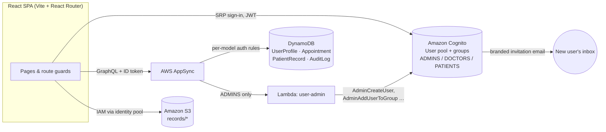
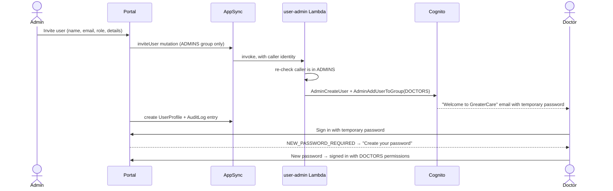

# GreaterCare: Secure Patient Record System

GreaterCare is a patient record and appointment system built on **AWS Amplify Gen 2**. Its main subject is **role-based access control (RBAC)**. Administrators provision every account and assign each one a role: Administrator, Doctor or Patient. The role decides what that person can see and do. The rules are enforced in AWS (Cognito, AppSync, S3 and Lambda), and the React interface only reflects them.

---

## Features

| Area | What it does |
|---|---|
| **Admin-only provisioning** | Public sign-up is disabled. An administrator creates the user, fills in their details and assigns a role. Cognito then emails a branded GreaterCare invitation with a temporary password. |
| **First-login activation** | The invited user signs in with the temporary password. The portal shows a guided "Create your password" step (Cognito `NEW_PASSWORD_REQUIRED`) with a live password-strength check. |
| **Account lifecycle** | Administrators can change a role (the user's sessions are revoked so the change applies at once), deactivate or reactivate an account, resend an invitation or delete an account. |
| **Appointment desk** | Patients request visits. Doctors claim them; a DynamoDB conditional write stops two doctors claiming the same visit. Administrators can assign or reassign doctors. Staff see updates live through an AppSync subscription. |
| **Clinical records** | Records hold vital signs, assessment, diagnosis, treatment plan, prescriptions, follow-up date and documents stored in S3. An allergy alert is shown while writing a record. Records can be printed or saved as PDF. |
| **Patient chart** | Shows a patient's details, allergies, record history and appointments together. |
| **Audit trail** | An append-only log: no API exists to update or delete an entry. It records sign-ins, account changes, record views and edits, and blocked page access. It can be exported to CSV. |
| **Access control page** | A role × capability table built from the same RBAC configuration the app uses. Each row shows where the rule is enforced. |
| **Session security** | Signs the user out after 15 minutes idle, with a warning first. Users can sign out of all devices. |
| **Design** | Responsive layout from phone to desktop, light and dark themes, keyboard focus states and print styles. |

## Architecture



### Provisioning flow



### Where each rule is enforced

| Layer | Enforcement |
|---|---|
| **Cognito** | Authenticates the user. Group membership travels as the `cognito:groups` claim in the signed JWT. |
| **AppSync** (`amplify/data/resource.ts`) | Group rules for staff. Owner rules for patients (`patientEmail` must equal the email in the token). `AuditLog` allows create-only for owners and read-only for ADMINS. |
| **S3** (`amplify/storage/resource.ts`) | Only the ADMINS and DOCTORS identity-pool roles have access to `records/*`. |
| **Lambda** (`amplify/functions/user-admin`) | Only this function has Cognito admin IAM permissions. It also checks the caller's group before acting. |
| **React** (`src/lib/rbac.js`, `RouteGuards.jsx`) | Hides routes and actions the role can't use and logs blocked attempts. This is for usability; the security boundary is the layers above. |

## Getting started

### 1. Install and deploy the backend

```sh
npm install
npx ampx sandbox          # deploys Cognito, AppSync, DynamoDB, S3 and Lambda; writes amplify_outputs.json
```

Leave the sandbox running while you develop. It redeploys when files in `amplify/` change.

### 2. Create the first administrator

Self sign-up is disabled, so the first admin has to be created outside the app. Use the AWS credentials you used for the sandbox:

```sh
node scripts/create-admin.mjs you@example.com Ada Lovelace
```

You'll receive the GreaterCare invitation email. Sign in with the temporary password and set your own password.

### 3. Run the portal

```sh
npm run dev
```

Go to **People & roles → Invite user** to provision doctors and patients.

### Optional configuration

| Variable (set before `ampx sandbox` / deploy) | Purpose |
|---|---|
| `GREATERCARE_PORTAL_URL` | The sign-in link in invitation emails (default `http://localhost:5173`). |
| `GREATERCARE_SES_FROM_EMAIL` | Sends emails from your own address (e.g. `no-reply@greatercare.health`) via Amazon SES, instead of Cognito's default sender. The address must be verified in SES. Cognito's default sender is limited to about 50 emails a day. |

### Hosting on Amplify

Add a single-page-app rewrite in **Amplify Console → Hosting → Rewrites and redirects** so deep links such as `/patients/…` load the app:

| Source | Target | Type |
|---|---|---|
| `</^[^.]+$\|\.(?!(css\|gif\|ico\|jpg\|js\|png\|txt\|svg\|woff\|woff2\|ttf\|map\|json\|webp)$)([^.]+$)/>` | `/index.html` | 200 (Rewrite) |

## Project structure

```
amplify/
  auth/                   Cognito: email login, groups, branded invitation template
  data/resource.ts        Models + authorization rules + admin-only custom operations
  functions/user-admin/   Lambda that wraps the Cognito admin APIs
  storage/resource.ts     S3 access rules for clinical documents
  backend.ts              Disables self sign-up; sets invitation expiry
scripts/create-admin.mjs  Creates the first administrator
src/
  router.jsx              Route map with RequireAuth / RequirePermission guards
  context/                AuthContext (session, role, profile) and FeedbackContext (toasts, confirm dialogs)
  lib/                    amplify client, rbac config, audit, user admin, appointments, records
  hooks/                  data hooks, idle timeout, theme
  components/             layout shell, route guards, UI kit
  pages/                  auth/, appointments/, records/, patients/, admin/, dashboard
  styles/                 design tokens, components, layout, auth, page styles
```

## Suggested demo for the defence

1. **Login page.** Self sign-up is disabled; only an administrator can create accounts.
2. **As the admin**, invite a doctor. The invitation preview shows the email before it is sent. Then show the email arriving in the inbox.
3. **In a private window**, sign in as the doctor with the temporary password. Show the "Create your password" step, then the doctor's dashboard.
4. **Back as the admin**, look at *People & roles*. The doctor's status has changed from *Invitation pending* to *Active*.
5. **As a patient**, request an appointment. On the doctor's screen the request appears live; the doctor takes it, writes an assessment with vitals and attaches a PDF.
6. **As the patient**, open the record. Then type `/admin/users` into the address bar: the request is refused with a 403 page, and the attempt appears in the admin's **Audit trail**.
7. Finish on **Access control**: the permission table and where each rule is enforced.

## Checks

```sh
npm run lint
npm run build
npx tsc -p amplify/tsconfig.json --noEmit   # type-check the backend
```
